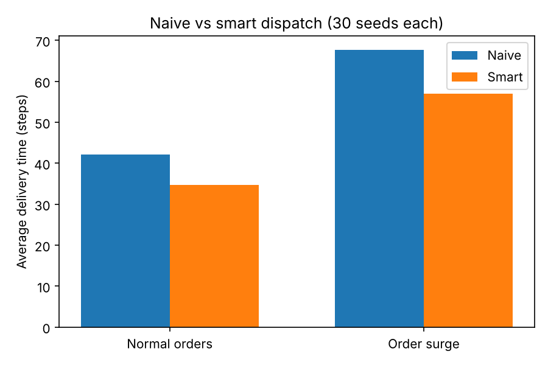

# DispatchLab

A warehouse robot fleet simulator in Python. It tests one question: **Does a smarter dispatcher beat first-come, first-served dispatch, and which part of it actually matters?**

> **Status:** first version complete. Results below.

---

## The question

Warehouses and delivery zones run fleets of robots. The hard part is deciding which robot takes which order, when to charge, and how to avoid blocked aisles. DispatchLab simulates that problem on a 2D grid and compares two dispatch strategies under identical conditions.

| Strategy | How it assigns an order |
|---|---|
| **Naive** | Gives the order to the first idle robot in the list, ignoring distance |
| **Smart** | Scores each idle robot on distance to the pickup plus a small penalty for low battery, then picks the lowest score |

Both strategies follow the same physical rules: a robot only accepts an order if its battery can cover the pickup, the delivery, and the trip to the dock afterwards, and idle robots below 50% battery go to charge.

## How the comparison is kept fair

- Both strategies run on the **same seeded sequence of orders**.
- Each scenario is **repeated over 30 seeds** and averaged, not judged from a single run.
- Results report **average delivery time, worst delivery time, and empty energy**, and also how often the smart strategy actually wins, since it does not win every time.

## What's in the simulation

- A 10x10 grid warehouse with a wall that has a gap at the top, eight pickup and drop-off stations, and a charging dock
- Four robots that drain battery as they move
- BFS pathfinding, so robots route around the wall
- A charging dock: robots with low battery stop, recharge, then resume
- An order queue with random arrivals, plus an **order surge** scenario where 15 of 30 orders arrive at once

## Progress

| Milestone | Goal | Status |
|---|---|---|
| 1 | Draw a grid and move one robot | Done |
| 2 | Block an aisle and reroute around it | Done |
| 3 | Four robots, battery drain, charging dock | Done |
| 4 | Order queue, naive and smart dispatch, metrics | Done |
| 5 | Run the comparison and write up results | Done |

## Results

I ran both dispatchers on the same seeded orders, 30 seeds per scenario. In the surge scenario, 15 of the 30 orders arrive at the same moment.



| Scenario | Dispatcher | Avg delivery time | Worst delivery time | Empty energy |
|---|---|---|---|---|
| Normal | Naive | 42.1 | 78.9 | 363.6 |
| Normal | Smart | 34.6 | 69.6 | 302.3 |
| Surge | Naive | 67.7 | 123.7 | 361.3 |
| Surge | Smart | 56.9 | 114.3 | 306.7 |

**What the numbers show**

- The smart dispatcher had the lower average delivery time in **27 of 30** normal seeds and **28 of 30** surge seeds.
- On average it cut delivery time by about 18% (normal) and 16% (surge), and reduced empty driving energy by about 17% and 15%.
- It did not win every seed, and during a surge the advantage on worst-case delivery time is smaller (about 8%).
- Most of this gain comes from choosing the nearest robot, not from the battery term (see the next section).

Times are in simulation steps, not real seconds. Empty energy is battery spent driving without an order. The raw per-run data is in [`results/results.csv`](results/results.csv).

## Does the battery term matter?

The smart dispatcher scores each idle robot as distance to the pickup plus a battery penalty. To check what the battery part contributes, I reran it with five penalty weights over the same 30 seeds per scenario.

| Scenario | Dispatcher | Avg delivery time | Beat naive |
|---|---|---|---|
| Normal | Naive | 42.1 | - |
| Normal | Smart, weight 0 (nearest robot only) | 34.9 | 27 of 30 |
| Normal | Smart, weight 0.1 | 34.6 | 27 of 30 |
| Normal | Smart, weight 0.5 | 35.2 | 27 of 30 |
| Normal | Smart, weight 1.0 | 36.0 | 27 of 30 |
| Normal | Smart, weight 2.0 | 36.7 | 25 of 30 |
| Surge | Naive | 67.7 | - |
| Surge | Smart, weight 0 (nearest robot only) | 57.3 | 28 of 30 |
| Surge | Smart, weight 0.1 | 56.9 | 28 of 30 |
| Surge | Smart, weight 0.5 | 57.1 | 29 of 30 |
| Surge | Smart, weight 1.0 | 58.4 | 27 of 30 |
| Surge | Smart, weight 2.0 | 60.1 | 25 of 30 |

**Finding:** in this setup the battery term adds almost nothing. Picking the nearest robot explains nearly all of the improvement, and heavier battery weights make delivery slower. A likely reason is that both dispatchers already follow battery rules (a robot only accepts an order it can finish, and idle robots below 50% go to charge), but I have not tested that explanation. Full data is in [`results/weight_experiment.csv`](results/weight_experiment.csv).

## Run it

Requires Python 3.9 or newer.

```bash
git clone https://github.com/NimraNadeemkhan/dispatchlab.git
cd dispatchlab
pip install -r requirements.txt
python src/run_experiment.py
```

Run it from the repository folder. It prints a summary table and writes `results/results.csv` and `results/comparison.png`.

To rerun the battery-weight test:

```bash
python src/battery_experiment.py
```

To watch the robots move, run the animated demos:

```bash
python milestones/milestone2/step4_pathfinding.py
python milestones/milestone3/step7_dock.py
```

## Project structure

```text
dispatchlab/
|-- README.md
|-- LICENSE
|-- requirements.txt
|-- milestones/                # step-by-step build history
|   |-- milestone1/            # grid drawing and one moving robot
|   |-- milestone2/            # wall obstacle and BFS pathfinding
|   |-- milestone3/            # Robot class, four-robot fleet, charging dock
|   `-- milestone4/            # order queue, naive vs smart dispatch, metrics
|-- src/
|   |-- run_experiment.py      # the full experiment: 30 seeds, two scenarios
|   `-- battery_experiment.py  # tests five battery penalty weights
`-- results/
    |-- results.csv            # one row per run
    |-- weight_experiment.csv  # battery weight experiment data
    `-- comparison.png         # bar chart of the comparison
```

## Design decisions and limitations

- It is a **simplified 2D grid simulation**, not a model of a real warehouse or real robot hardware.
- The battery model uses **simple assumed drain and charging rates**, not measured values.
- The smart score weight (0.1 per battery percent), the station layout, and the number of orders are my choices. I did not tune the weight to improve the results.
- The smart dispatcher's gain comes almost entirely from choosing the nearest robot. A battery penalty added nothing in this setup (see the battery experiment above).
- Robots do not avoid each other yet: they can share a cell.
- The charging dock has no capacity limit, so several robots can charge at the same cell at once.
- Fleet-management systems such as Open-RMF solve the same kind of problem at a much larger scale. This project is a learning-scale version of the idea.

## What I learned

- Python fundamentals: lists, loops, functions, and classes
- Breadth-first search for pathfinding around obstacles
- Modelling a system with states (idle, to pickup, to drop-off, to dock, charging)
- Designing a fair experiment: seeded inputs, repeated runs, and reporting where the result is weaker
- Testing my own assumption: the battery term I expected to matter turned out not to

## Possible next steps

- Test whether the battery term matters when batteries are smaller or the warehouse is larger
- Add collision avoidance and a limited number of dock slots
- Try A* pathfinding in place of BFS
- A heat-aware mode where hot conditions change battery drain and dispatch choices
- A browser-based version of the simulation

## About

Built by Nimra Nadeem, a Business Systems Engineer based in the UAE, as a first step toward robotics and logistics automation work.

## License

MIT
