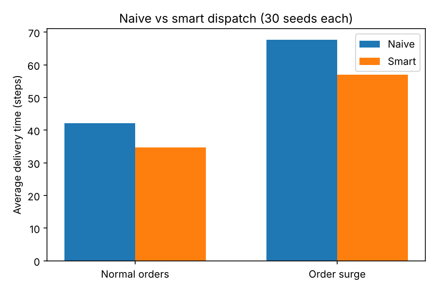

# DispatchLab

A warehouse robot fleet simulator in Python. It tests one question: **Does battery- and distance-aware dispatch outperform first-come, first-served dispatch, and when?**

> **Status:** work in progress (week 1 build). Results will be added once the comparison has been run.

---

## The question

Warehouses and delivery zones run fleets of robots. The hard part is deciding which robot takes which order, when to charge, and how to avoid blocked aisles. DispatchLab simulates that problem on a 2D grid and compares two dispatch strategies under identical conditions.

| Strategy | How it assigns an order |
|---|---|
| **Naive** | Gives the order to the next free robot (first come, first served) |
| **Smart** | Scores each robot on distance to the pickup and remaining battery, then picks the best |

## How the comparison will be kept fair

- Both strategies run on the **same seeded sequence of orders**.
- Each scenario is **repeated over many runs** and averaged, not judged from a single run.
- Results will report **orders per hour, average delivery time, and energy wasted**, including cases where the gap is small or the smart strategy loses.

## What's in the simulation

- A grid warehouse with a wall, a charging dock, and goal cells
- Four robots that drain battery as they move
- BFS pathfinding, so robots route around blocked aisles
- A charging dock: a robot with low battery stops its delivery, recharges, then resumes
- Still to come: an order queue, order surges, and the two dispatchers

## Progress

| Milestone | Goal | Status |
|---|---|---|
| 1 | Draw a grid and move one robot | Done |
| 2 | Block an aisle and reroute around it | Done |
| 3 | Four robots, battery drain, charging dock | Done |
| 4 | Order queue, naive and smart dispatch, metrics | Done |
| 5 | Run the comparison and write up results | Next |

## Run it

Requires Python 3.9 or newer.

```bash
git clone https://github.com/NimraNadeemkhan/dispatchlab.git
cd dispatchlab
pip install -r requirements.txt
python milestones/milestone3/step7_dock.py
```

You should see four robots cross a wall through a gap at the top. The low-battery robots stop at the green dock in the corner to recharge before finishing their deliveries. The terminal prints each event and ends with the total number of steps.

## Project structure

```text
dispatchlab/
|-- README.md
|-- requirements.txt
|-- milestones/        # step-by-step learning history
|   |-- milestone1/    # grid drawing and one moving robot
|   |-- milestone2/    # wall obstacle and BFS pathfinding
|   `-- milestone3/    # Robot class, four-robot fleet, charging dock
|-- src/               # the final simulation (added as it is built)
|-- results/           # comparison outputs (added after the runs)
`-- docs/              # screenshots and notes
```

## Results

I ran both dispatchers on the same seeded orders, 30 seeds per scenario. In the surge scenario, 15 of the 30 orders arrive at the same moment.



| Scenario | Dispatcher | Avg delivery time | Worst delivery time | Empty energy |
|---|---|---|---|---|
| Normal | Naive | 42.1 | 78.9 | 363.6 |
| Normal | Smart | 34.6 | 69.6 | 302.3 |
| Surge | Naive | 67.7 | 123.7 | 361.3 |
| Surge | Smart | 56.9 | 114.3 | 306.7 |

The smart dispatcher had the lower average delivery time in 27 of 30 normal seeds and 28 of 30 surge seeds. Times are in simulation steps. Empty energy is battery spent driving without an order. The smart score weights (distance plus a small battery penalty) are assumptions, not tuned values, and this is a simplified simulation, so the results show a pattern in this setup and not a real-world claim.## Design decisions and limitations

- It is a **simplified 2D grid simulation**, not a model of a real warehouse or real robot hardware.
- The battery model uses **simple assumed drain rates**, not measured values.
- Robots do not avoid each other yet: they can share a cell, and the simulation only counts overlaps.
- The charging dock has no capacity limit, so several robots can charge at the same cell at once.
- Fleet-management systems such as Open-RMF solve the same kind of problem at a much larger scale. This project is a learning-scale version of the idea.

## Possible next steps

- A* pathfinding in place of the first search method
- A heat-aware mode where hot conditions change battery drain and dispatch choices
- A browser-based version of the simulation

## About

Built by Nimra Nadeem, a Business Systems Engineer based in the UAE, as a first step toward robotics and logistics automation work.

## License

MIT
